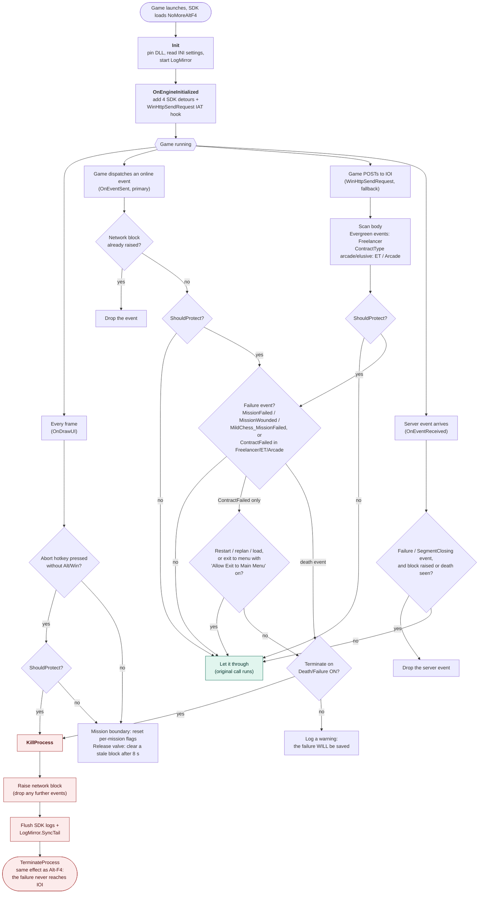

# How NoMoreAltF4 works

> These diagrams cover the Terminate path (the default). Seamless protection and the saving option, added in 1.0.0, are described in the [README](../README.md).

There are four ways a kill can be triggered:

- **Abort hotkey.** The player presses the abort key.
- **Outgoing event, the primary path.** The game dispatches a failure event, which is seen in `OnEventSent` before it is batched into an HTTP request.
- **HTTP POST, the fallback path.** A failure event is found in a `SaveEvents2` body inside the `WinHttpSendRequest` hook, before the original send runs.
- **Server event, a guard.** While protection is active, failure confirmations coming back from the server are dropped.

Every kill path ends in `KillProcess`, which terminates the game before the failure reaches IOI's servers.

`ShouldProtect` is true unless **Freelancer only** is on and the current mission is not Freelancer.

Unloading the mod at runtime takes a separate path. The destructor sets the IAT hook to passthrough, swaps the import table to a persistent jump stub, waits up to 2 s for in-flight calls to finish, and stops LogMirror. The DLL stays pinned so the game never runs code from freed memory.
