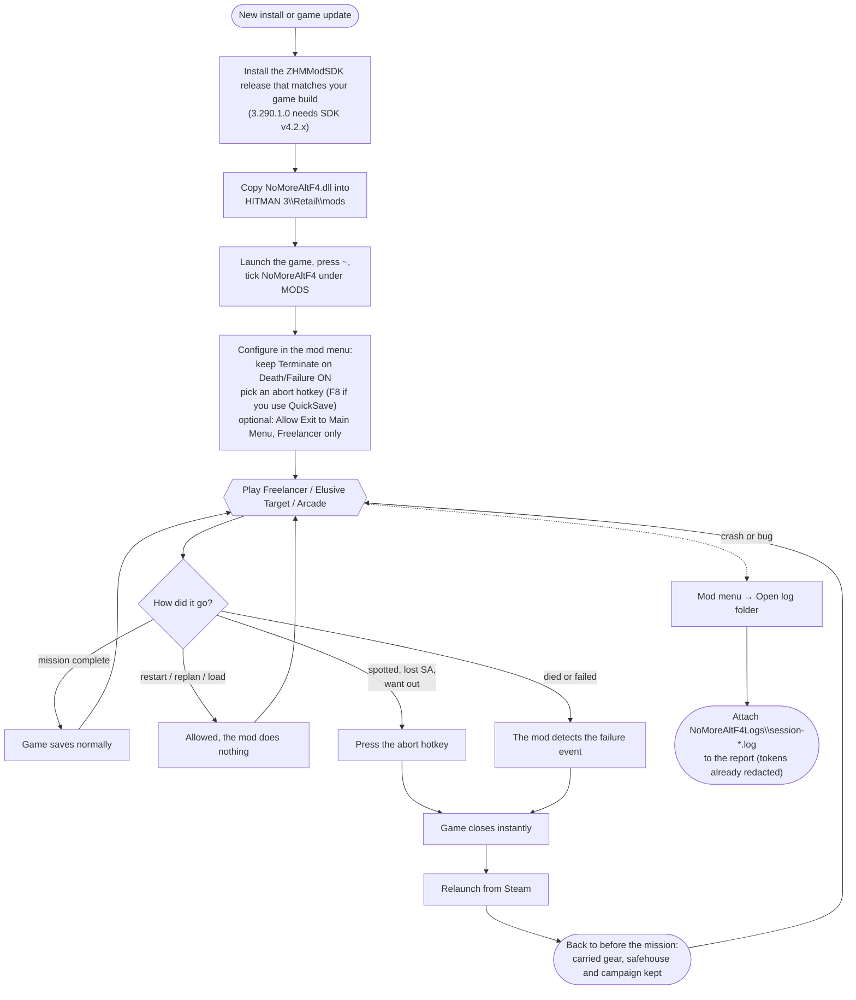
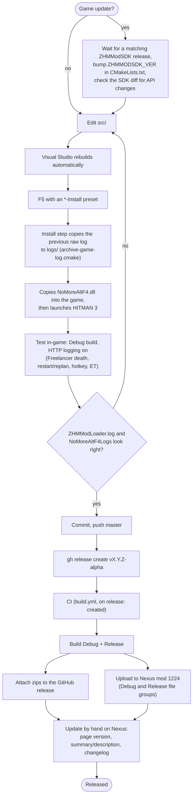

# NoMoreAltF4 workflows

> These diagrams cover the Terminate path (the default). Seamless protection and the saving option, added in 1.0.0, are described in the [README](../README.md).

## Player workflow

This covers installing the mod, setting it up, and what happens during a mission.

## Developer and release workflow

This covers changing the code, testing it in-game, and shipping a version to GitHub and Nexus.

